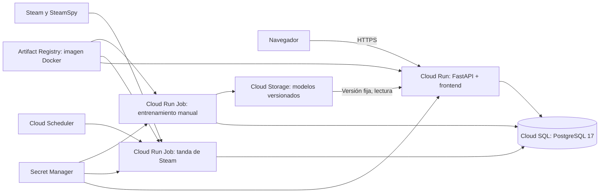

# GameTrack en Google Cloud

Propuesta de arquitectura para el MVP, revisada el 7 de octubre de 2026.
La implementación está en [deploy/google-cloud](deploy/google-cloud/README.md).
Aplicación publicada en [GameTrack](https://gametrack-591398735968.us-central1.run.app),
proyecto `gametrack-510920`, región `us-central1`. Datos migrados y modelo
entrenado en la nube. Ver [registro del despliegue](deploy/google-cloud/DEPLOYMENT.md).

## Crédito de bienvenida

Google ofrece USD 300 de crédito durante 90 días para nuevos usuarios elegibles.
Es un crédito total, no USD 300 mensuales. La elegibilidad depende del historial
de la cuenta. Sin convertirla explícitamente a una cuenta de pago, la prueba
termina al consumir el crédito o llegar a los 90 días y los servicios pueden
dejar de funcionar. No considerar el crédito como alojamiento gratuito permanente.

Fuente: [condiciones y elegibilidad](https://cloud.google.com/signup-faqs).

## Arquitectura recomendada



La aplicación ya sirve frontend y API desde FastAPI. Se conserva una sola URL
y el mismo contenedor. La base y los archivos duraderos viven fuera de Cloud
Run. La PC sólo se necesita para desarrollar: los usuarios y las tandas de
Steam siguen funcionando con la PC apagada.

| Componente | Configuración inicial propuesta |
|---|---|
| Región | `us-central1` para presupuestar; todos los componentes en la misma región. Medir latencia desde Argentina antes de fijarla. |
| Servicio web | Cloud Run, entorno de segunda generación, 1 vCPU, 2 GiB, facturación por solicitudes, mínimo 0 y máximo 2 instancias; concurrencia inicial 8. |
| Base | Cloud SQL Enterprise, PostgreSQL 17, `db-g1-small`, una zona, SSD inicial de 10 GiB, backups diarios y recuperación a un punto en el tiempo. |
| Sincronización | Cloud Run Job, 1 tarea, paralelismo 1, 1 vCPU y 1 GiB; presupuesto de tanda de 360 s, timeout del job de 900 s y cero reintentos automáticos inicialmente. |
| Frecuencia | Cada 6 horas como punto de partida; estado y cola persistidos en PostgreSQL. |
| Modelo de IA | Entrenamiento manual en otro job, inicialmente 1 vCPU y 2 GiB; objeto `.npz` versionado en bucket privado. |
| Secretos | URL de la base, clave JWT estable y clave de Steam en Secret Manager. |
| Imagen | Una imagen versionada por revisión de código en Artifact Registry, compartida por servicio y jobs. |
| Observabilidad | Logs de ejecuciones y métricas de Cloud Run; presupuesto mensual con alertas de consumo. |

Son valores iniciales del piloto. Se verificaron arranque y recomendaciones
con el catálogo migrado; todavía no se hizo una prueba de carga. El motor
precalienta sus estructuras al iniciar. Con mínimo 0 puede haber demora al
primer acceso tras un período sin tráfico. Para una defensa se puede mantener
una instancia temporalmente y recalcular ese costo.

Las máquinas Cloud SQL de CPU compartida no tienen el SLA de Cloud SQL; esta
configuración corresponde al prototipo. Alta disponibilidad y mayor capacidad
requieren otro presupuesto.

## Conexión, accesos y persistencia

- Conectar servicio y jobs con la integración Cloud SQL de Cloud Run y el
  socket `/cloudsql/PROYECTO:REGION:INSTANCIA`. Usar IP pública de Cloud SQL
  sin redes autorizadas y autenticación mediante la integración; no abrir
  PostgreSQL a internet. Evita agregar un conector VPC al MVP.
- Mantener una conexión PostgreSQL de sesión: el importador coordina sus
  ejecuciones mediante bloqueos de sesión. No usar un pooler por transacción.
- Separar cuentas de servicio para web, sincronización, entrenamiento y
  Scheduler. Conceder `Cloud SQL Client`, lectura de los secretos necesarios
  y permisos de bucket según su función. Scheduler sólo invoca el job mediante
  OAuth y el permiso de invocación correspondiente.
- Publicar el frontend por HTTPS en la URL de Cloud Run. Los datos privados
  siguen protegidos por la autenticación de GameTrack. Configurar
  `PUBLIC_BASE_URL` con ese origen para el regreso del login de Steam.
- La web necesita `STEAM_API_KEY` si se habilitan biblioteca/perfil y otras
  funciones que consultan Steam Web API; el job la necesita para el índice.
- El modelo debe leerse desde una versión fija del bucket, mediante montaje
  de sólo lectura o descarga al arrancar. Publicar una revisión de la web
  cuando cambie la versión. El job entrena en almacenamiento temporal, sube
  el resultado completo a una ruta nueva y sólo después se activa esa versión.
- No guardar SQLite ni el modelo definitivo en el disco temporal de Cloud Run.
  Los volúmenes de Docker Compose tampoco se trasladan automáticamente.

## Ajustes concretos sobre este repositorio

1. Reutilizar `Dockerfile`, `backend/requirements-postgres.txt` y Alembic.
   Cloud Run debe configurarse con puerto de contenedor **8000**, igual al
   comando actual, o adaptar el arranque a su variable `PORT`.
2. Para web y sincronizador definir `ENVIRONMENT=production`,
   `DB_AUTO_CREATE=false`, `STEAM_CATALOG_WORKER_MODE=scheduled` y
   `STEAM_CATALOG_WORKER_ENABLED=true`. El modo programado evita iniciar
   el bucle continuo dentro del servicio web.
3. Empezar con `STEAM_CATALOG_REQUESTED_ONLY=true`,
   `STEAM_CATALOG_PAGE_SIZE=1000`, `STEAM_CATALOG_INTERVAL_MINUTES=360`,
   `STEAM_CATALOG_DETAIL_BATCH_SIZE=5` y un límite de 10 reseñas importadas
   por juego. Revisar cobertura y demora antes de ampliar la ingesta.
4. Usar el ejecutable de tandas existente en el job:

   ```text
   python -m app.workers.steam_catalog_batch --seconds 360 --max-cycles 60 --max-db-mib 2048
   ```

   El límite de 2 GiB es un freno de ingesta, no un límite de facturación ni
   de crecimiento por otras escrituras. La tanda conserva progreso y puede
   terminar antes por inactividad, bloqueo, error o límite de almacenamiento.
5. Ejecutar migraciones mediante un job manual, antes de iniciar la web o las
   tandas; no ejecutarlas al arrancar cada réplica.
6. Configurar `LOCAL_MODEL_PATH` con el archivo versionado accesible en la web.
   `.dockerignore` excluye `backend/data/generated`, por lo que el modelo local
   actual no estará incluido en la imagen.
7. El pool web se limita a dos conexiones y cero overflow; el sincronizador
   usa tres para datos, bloqueo y latido. Revisar esos límites si cambia el
   máximo de instancias o la capacidad de Cloud SQL.
8. Usar la configuración Terraform y la construcción con Cloud Build de
   `deploy/google-cloud`, con etapas separadas para infraestructura, secretos,
   jobs, migración, modelo, web y Scheduler. Su ejecución requiere el proyecto
   y la sesión de Google Cloud del titular.

## Migrar los datos actuales

El archivo SQLite observado ocupa aproximadamente 249 MiB, sin sumar sus
archivos auxiliares. El tamaño final en PostgreSQL se debe medir; no es una
base que deba ir dentro de la imagen o del repositorio.

1. Detener escrituras locales y obtener un backup consistente mediante SQLite.
2. Crear la base destino vacía y ejecutar `alembic upgrade head`.
3. Validar con `scripts/copy_sqlite_to_postgres.py --source <copia>`; resolver
   incompatibilidades sobre una copia si las hubiera.
4. Ejecutar la copia con `--execute`, sin web ni sincronizador escribiendo.
   Usar un canal privado, por ejemplo Cloud SQL Auth Proxy durante la migración.
5. Comparar recuentos y relaciones, probar login y catálogo; conservar el backup
   local para recuperación. No ejecutar un seed con reset sobre el destino.
6. Volver a entrenar el modelo contra la nueva base, con su procedencia correcta,
   y publicar el artefacto en el bucket. El recomendador general funciona
   mientras se prepara ese modelo.
7. Habilitar web y Scheduler sólo después de validar la transferencia.

El procedimiento y las garantías de la herramienta están en [DESPLIEGUE.md](DESPLIEGUE.md).

## Presupuesto del piloto

Estimación de planificación: **USD 30–60 mensuales**, aproximadamente
**USD 90–180 por tres meses**, antes de impuestos y suponiendo poco tráfico,
base pequeña, cero instancias web mínimas y cuatro tandas diarias.
No es una cotización cerrada ni una garantía de consumo.

Como referencia, la tabla consultada de Cloud SQL publica `db-g1-small` a
USD 0,035/h: unas 730 h representan USD 25,55 sólo de cómputo. Hay que agregar
disco, backups, red/IP, web, ejecuciones, builds, imágenes y almacenamiento.
Confirmar todos los precios con la región seleccionada en la calculadora.

Cloud Run tiene franquicias mensuales según tipo de facturación y región.
Cuatro tandas de 360 s por día durante 30 días equivalen a 43.200 vCPU-s con
1 vCPU; timeout, llamadas pendientes, entrenamiento y ejecuciones manuales
pueden incrementar ese uso. Scheduler ofrece tres tareas programadas gratis
por cuenta de facturación; eso no convierte sus ejecuciones en cómputo gratis.

Configurar alertas de costo bruto excluyendo créditos promocionales para
ver cuánto se está consumiendo del crédito, por ejemplo al 50/80/100 % de un
presupuesto de USD 60 al mes. Un presupuesto sólo de alertas no corta el
gasto. Mantener límites de instancias, duración de jobs, retención de imágenes
y volumen de ingesta; decidir antes del día 90 cómo continuar o exportar datos.

## Verificación antes de compartir la URL

- Healthcheck, frontend, registro/login y autorización por rol.
- Login de Steam con el origen HTTPS, biblioteca y perfiles si se habilitan.
- Catálogo, reseñas, recomendaciones individuales y grupales con datos migrados.
- Tanda manual de Steam y ejecución desde Scheduler con la web inactiva.
- Persistencia tras detener/recrear una instancia y recarga del modelo correcto.
- Backup/restauración de PostgreSQL y observación de costos, memoria y latencia.

La arquitectura está basada en los componentes existentes y documentación
oficial. Las pruebas efectivas del despliegue se registran en
[deploy/google-cloud](deploy/google-cloud/README.md).

## Fuentes oficiales

- [Prueba gratuita y elegibilidad](https://cloud.google.com/signup-faqs).
- [Precios de Cloud Run](https://cloud.google.com/run/pricing).
- [Precios de Cloud SQL](https://cloud.google.com/sql/pricing).
- [Precios de Cloud Scheduler](https://cloud.google.com/scheduler/pricing).
- [Programar Cloud Run Jobs](https://docs.cloud.google.com/run/docs/execute/jobs-on-schedule).
- [Cloud Run con PostgreSQL en Cloud SQL](https://docs.cloud.google.com/sql/docs/postgres/connect-run).
- [Presupuestos y alertas](https://docs.cloud.google.com/billing/docs/how-to/budgets).
- [Montar Cloud Storage en Cloud Run](https://docs.cloud.google.com/run/docs/configuring/services/cloud-storage-volume-mounts).
